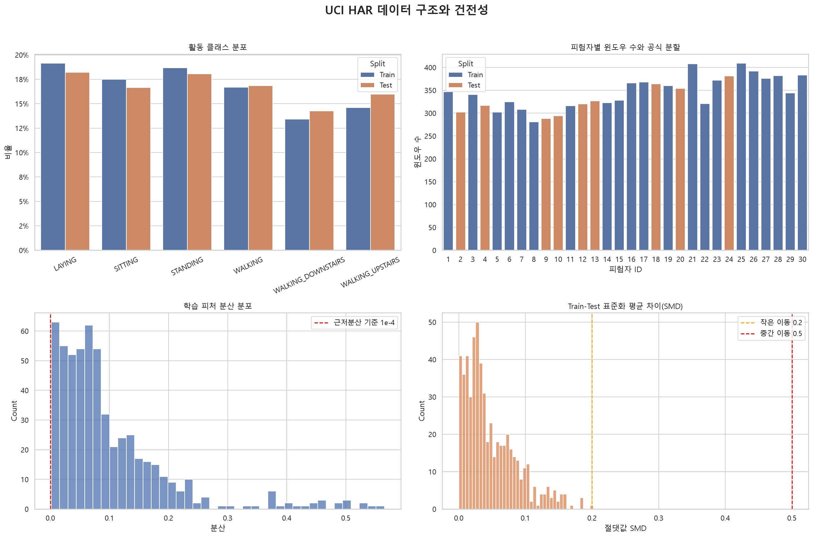
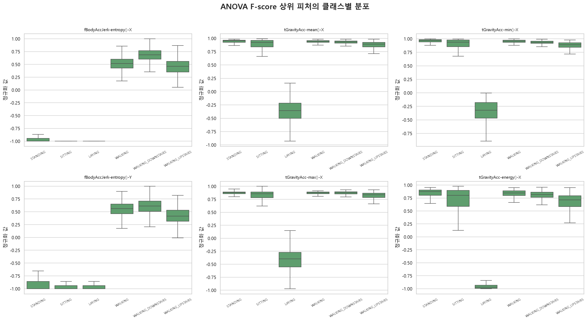
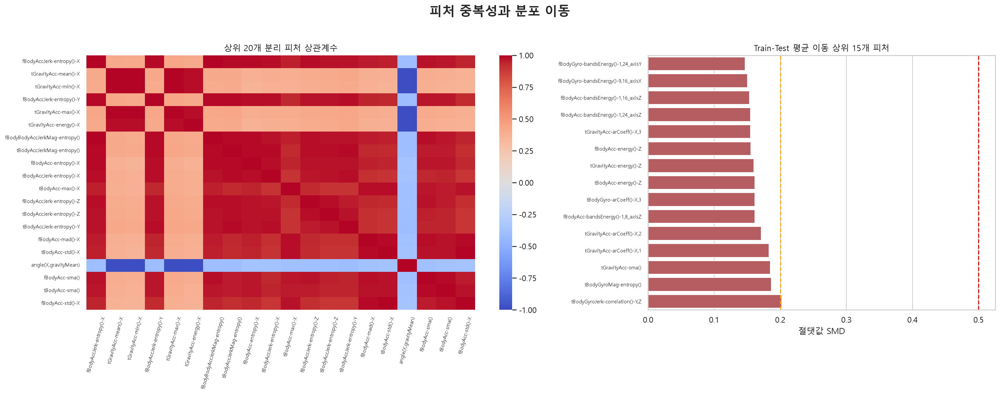

# UCI HAR 데이터 탐색적 분석 보고서

## 1. 분석 목적과 올바른 EDA 접근법

이 보고서는 스마트폰 센서 기반 Human Activity Recognition 데이터로 **Random Forest 다중 분류 모델**을 만들기 전에 수행해야 할 EDA를 정리한다. EDA는 단순히 그래프를 많이 그리는 과정이 아니라 다음 질문에 증거로 답하는 과정이다.

1. **관측 단위와 타깃은 무엇인가?** 한 행은 한 사람이 아니라 2.56초 길이의 센서 윈도우이며, 타깃은 6개 활동이다.
2. **결측·무한값·중복·범위 오류가 있는가?** 모델이 숫자를 읽을 수 있는지뿐 아니라 동일 관측이 반복되어 평가가 부풀려지는지도 확인한다.
3. **표본이 독립적인가?** 같은 피험자의 인접 윈도우가 50% 겹치므로 행 단위 무작위 분할은 데이터 누수를 일으킬 수 있다.
4. **타깃이 불균형한가?** 전체 정확도가 소수 클래스를 가리지 않는지 확인하고 Macro F1과 클래스별 Recall을 설계한다.
5. **피처가 유용하고 중복되지 않는가?** 분산, 클래스별 분포, 상관관계, 단변량 분리도를 학습 데이터에서만 진단한다.
6. **Train과 Test의 분포가 다른가?** 피험자가 다르기 때문에 실제 일반화 난도를 나타내는 분포 이동을 점검한다.
7. **예정 모델의 특성과 맞는가?** Random Forest는 스케일링이 필요 없지만, 강한 상관 피처는 중요도를 여러 변수에 분산시키므로 해석 방식을 조정해야 한다.

EDA의 원칙은 **테스트셋을 모델 선택이나 피처 선택에 사용하지 않는 것**이다. 아래 클래스 비율과 분포 이동은 테스트셋의 건전성 확인용이며, 실제 하이퍼파라미터 및 피처 선택은 학습셋 내부의 피험자 그룹 교차검증으로 수행해야 한다.

## 2. 데이터 정의와 실험 설계

- 분석 피처 입력: `data/har_features.csv`
- 분석 타깃 입력: `data/har_targets.csv`
- 피험자·공식 분할 보조 정보: `data/UCI HAR Dataset/train|test/subject_*.txt`
- 피험자: 19~48세 자원자 30명
- 센서: 허리 위치 Samsung Galaxy S II의 3축 가속도계와 자이로스코프
- 샘플링: 50 Hz
- 관측 윈도우: 2.56초, 128개 측정값, 인접 윈도우 50% 중첩
- 입력 피처: 시간·주파수 영역에서 계산된 561개 수치 피처
- 타깃: `WALKING`, `WALKING_UPSTAIRS`, `WALKING_DOWNSTAIRS`, `SITTING`, `STANDING`, `LAYING`
- 값 범위: 사전 정규화되어 대체로 [-1, 1]
- 공식 분할: 피험자 기준 Train 21명 / Test 9명

| 구분 | 행 수 | 피처 수 | 피험자 수 |
| --- | ---: | ---: | ---: |
| Train | 7,352 | 561 | 21 |
| Test | 2,947 | 561 | 9 |
| 전체 | 10,299 | 561 | 30 |

- Train 피험자 ID: 1, 3, 5, 6, 7, 8, 11, 14, 15, 16, 17, 19, 21, 22, 23, 25, 26, 27, 28, 29, 30
- Test 피험자 ID: 2, 4, 9, 10, 12, 13, 18, 20, 24
- 두 집합의 피험자 교집합: **0명**



## 3. 데이터 건전성 점검

| 점검 항목 | Train | Test | 해석 |
| --- | ---: | ---: | --- |
| 결측치 | 0 | 0 | 별도 대체 불필요 |
| 무한값 | 0 | 0 | 수치 연산 안전 |
| 완전 중복 행 | 0 | 0 | 동일 피처 벡터 중복 없음 |
| 관측 최솟값 | -1.000000 | - | 정규화 범위 확인 |
| 관측 최댓값 | 1.000000 | - | 정규화 범위 확인 |

추가 점검 결과:

- 분산이 정확히 0인 피처: **0개**
- 분산이 `1e-4` 미만인 근저분산 피처: **0개**
- 값이 완전히 동일한 중복 피처 열: **21개**
- 원본 `features.txt`에서 중복 이름으로 표기된 엔트리: **126개**. 분석 코드에서는 피처 ID를 접두어로 붙여 이름 충돌을 방지했다.
- IQR 기준 피처별 이상치 비율 중앙값: **1.16%**, 최댓값: **37.79%** (`tBodyAccJerk-mean()-X`). 센서 행동 데이터는 다봉 분포이므로 IQR 이상치를 오류로 간주해 일괄 삭제하면 안 된다.

**판단:** 결측치와 무한값이 없어 Random Forest 입력을 위한 대체 처리는 현재 필요 없다. 향후 운영 데이터까지 고려하면 `SimpleImputer(strategy="median")`를 파이프라인에 안전장치로 둘 수 있다. 이미 정규화된 값이며 트리 모델은 단조 변환에 불변이므로 `StandardScaler`는 필요 없다. 완전히 동일한 21개 중복 열은 계산량과 중요도 분산을 줄이기 위해 제거할 수 있지만, 반드시 Train에서 중복 여부와 유지 열을 결정한 뒤 동일한 열 선택을 Validation/Test에 적용해야 한다.

## 4. 타깃 분포와 피험자 구조

| Activity | Train_Count | Train_Rate | Test_Count | Test_Rate |
| --- | --- | --- | --- | --- |
| LAYING | 1407 | 19.14 | 537 | 18.22 |
| SITTING | 1286 | 17.49 | 491 | 16.66 |
| STANDING | 1374 | 18.69 | 532 | 18.05 |
| WALKING | 1226 | 16.68 | 496 | 16.83 |
| WALKING_DOWNSTAIRS | 986 | 13.41 | 420 | 14.25 |
| WALKING_UPSTAIRS | 1073 | 14.59 | 471 | 15.98 |

표의 비율 단위는 `%`이다. 학습셋의 최대/최소 클래스 표본비는 **1.43:1**로 심각한 불균형은 아니다. 모든 학습 피험자가 최소 **6개 활동**을 수행했다.

그러나 한 피험자에서 많은 윈도우가 반복 생성되므로 행은 독립 표본이 아니다. 인접 윈도우는 원시 신호의 절반을 공유한다. 따라서 `train_test_split(..., stratify=y)`로 행을 무작위 분할하면 동일 피험자의 매우 유사한 윈도우가 양쪽에 들어가 과도하게 낙관적인 점수가 나올 수 있다.

**권장 평가 설계:**

- 최종 평가는 제공된 공식 Test를 그대로 사용한다.
- 하이퍼파라미터 선택은 Train에서 `StratifiedGroupKFold`를 사용하고 `groups=subject_train`으로 지정한다.
- 정확도와 함께 `Macro F1`, `Balanced Accuracy`, 클래스별 Recall, 혼동행렬을 보고한다.

## 5. 피처 분포와 클래스 분리도

ANOVA F-score는 각 피처가 활동 클래스를 단변량으로 얼마나 잘 분리하는지 보는 **탐색용 순위**이다. 이 순위는 학습셋에서만 계산했으며, 피처 간 상호작용이나 인과성을 의미하지 않는다.

| Raw_Feature | F_Score | P_Value |
| --- | --- | --- |
| fBodyAccJerk-entropy()-X | 36918.10 | 0.000e+00 |
| tGravityAcc-mean()-X | 29362.64 | 0.000e+00 |
| tGravityAcc-min()-X | 28175.40 | 0.000e+00 |
| fBodyAccJerk-entropy()-Y | 28115.92 | 0.000e+00 |
| tGravityAcc-max()-X | 26686.80 | 0.000e+00 |
| tGravityAcc-energy()-X | 25981.56 | 0.000e+00 |
| fBodyBodyAccJerkMag-entropy() | 23619.25 | 0.000e+00 |
| tBodyAccJerkMag-entropy() | 23437.11 | 0.000e+00 |
| fBodyAcc-entropy()-X | 23221.61 | 0.000e+00 |
| tBodyAccJerk-entropy()-X | 22267.09 | 0.000e+00 |



상위 피처는 신체 가속도 Jerk의 엔트로피와 X축 중력가속도의 평균·최솟값·최댓값·에너지 계열이다. 정적 활동(`SITTING`, `STANDING`, `LAYING`)과 동적 활동(`WALKING` 계열)의 분리는 비교적 뚜렷하지만, `SITTING`과 `STANDING`은 유사한 센서 패턴을 보여 주요 오분류 후보가 된다. Random Forest의 비선형 분기와 피처 상호작용이 이 문제에 적합하다.

## 6. 상관관계, 중복성, 유효 차원

- 절댓값 상관계수 0.95 이상 피처 쌍: **2,281쌍**
- 절댓값 상관계수 0.99 이상 피처 쌍: **207쌍**
- 학습 데이터 분산의 90%를 설명하는 주성분 수: **34개**
- 95% 설명 주성분 수: **67개**
- 99% 설명 주성분 수: **155개**

가장 강한 상관 피처 쌍:

| Feature_1 | Feature_2 | Correlation |
| --- | --- | --- |
| fBodyBodyGyroMag-mean() | fBodyBodyGyroMag-sma() | 1.000000 |
| tBodyAccMag-sma() | tGravityAccMag-sma() | 1.000000 |
| tBodyAccMag-iqr() | tGravityAccMag-iqr() | 1.000000 |
| tBodyGyroJerkMag-mean() | tBodyGyroJerkMag-sma() | 1.000000 |
| tBodyAccMag-entropy() | tGravityAccMag-entropy() | 1.000000 |
| tBodyAccMag-energy() | tGravityAccMag-energy() | 1.000000 |
| tBodyAccMag-sma() | tGravityAccMag-mean() | 1.000000 |
| tBodyAccMag-max() | tGravityAccMag-max() | 1.000000 |
| tBodyAccMag-mean() | tGravityAccMag-mean() | 1.000000 |
| tBodyAccMag-mean() | tBodyAccMag-sma() | 1.000000 |



561개 피처에 상당한 중복이 있다. Random Forest 예측 자체는 다중공선성에 비교적 강하지만 다음 해석상 문제가 있다.

- 서로 비슷한 피처가 분할 후보를 나눠 가지므로 기본 `feature_importances_`가 희석되거나 불안정해질 수 있다.
- 연속형·고유값이 많은 피처에 불순도 기반 중요도가 편향될 수 있다.
- 최종 해석에는 공식 Test 또는 그룹 기반 검증 fold의 **Permutation Importance**를 함께 사용해야 한다.

상관 피처를 반드시 사전 제거할 필요는 없다. 우선 `max_features="sqrt"` 등으로 각 트리의 후보 피처를 제한하고, 계산량이나 해석성이 문제일 때만 학습 fold 안에서 상관 기반 제거를 검토한다.

## 7. Train-Test 분포 이동

피험자 집합이 완전히 다르므로 Train과 Test에 어느 정도 분포 이동이 존재하는 것이 자연스럽다. 절댓값 표준화 평균 차이(SMD)를 사용한 결과:

- SMD 0.20 이상 피처: **1개**
- SMD 0.50 이상 피처: **0개**

이동이 큰 상위 피처:

| Feature | Train_Mean | Test_Mean | Abs_SMD |
| --- | --- | --- | --- |
| tBodyGyroJerk-correlation()-Y,Z | -0.1286 | -0.0763 | 0.2021 |
| tBodyGyroMag-entropy() | 0.2101 | 0.2986 | 0.1863 |
| tGravityAcc-sma() | -0.0783 | -0.1491 | 0.1849 |
| tGravityAcc-arCoeff()-X,1 | -0.5158 | -0.4760 | 0.1828 |
| tGravityAcc-arCoeff()-X,2 | 0.5532 | 0.5172 | 0.1711 |
| fBodyAcc-bandsEnergy()-1,8_axisZ | -0.8480 | -0.8804 | 0.1616 |
| tBodyGyro-arCoeff()-X,3 | 0.1391 | 0.1020 | 0.1614 |
| tBodyAcc-energy()-Z | -0.8458 | -0.8768 | 0.1613 |
| tGravityAcc-energy()-Z | -0.7447 | -0.8108 | 0.1599 |
| fBodyAcc-energy()-Z | -0.8304 | -0.8633 | 0.1552 |

이는 데이터 오류라기보다 새로운 사람에게 일반화해야 하는 실제 난도를 반영한다. Test 분포에 맞춰 전처리하거나 피처를 선택하면 누수이므로, 모든 선택은 Train 내부 그룹 교차검증에서 수행해야 한다.

## 8. Random Forest 모델링 권고안

### 전처리

1. `X_train`, `y_train`, `subject_train`을 함께 로드한다.
2. 결측치가 현재 없으므로 삭제나 대체는 하지 않는다. 운영 안전장치가 필요하면 학습 fold에서만 중앙값을 학습하는 `SimpleImputer`를 사용한다.
3. 완전 중복 피처 제거를 적용한다면 학습 fold에서 유지 열을 결정하고 Validation/Test에는 그 결정을 그대로 적용한다.
4. `StandardScaler`는 적용하지 않는다.
5. 공식 Test는 최종 1회 평가 전까지 격리한다.
6. 추가 피처 선택이 필요하면 반드시 그룹 교차검증 Pipeline 내부에서 수행한다.

### 권장 교차검증과 탐색 범위

```python
from sklearn.ensemble import RandomForestClassifier
from sklearn.model_selection import RandomizedSearchCV, StratifiedGroupKFold

cv = StratifiedGroupKFold(n_splits=5, shuffle=True, random_state=42)

model = RandomForestClassifier(
    random_state=42,
    n_jobs=-1,
    class_weight="balanced_subsample",
)

param_distributions = {
    "n_estimators": [300, 500, 800],
    "max_depth": [None, 12, 20, 30],
    "min_samples_split": [2, 5, 10],
    "min_samples_leaf": [1, 2, 4],
    "max_features": ["sqrt", "log2", 0.3],
    "bootstrap": [True],
}

search = RandomizedSearchCV(
    model,
    param_distributions=param_distributions,
    n_iter=30,
    scoring="f1_macro",
    cv=cv,
    n_jobs=-1,
    random_state=42,
)
search.fit(X_train, y_train, groups=subject_train)
```

### 평가 지표

- 1순위: `Macro F1` — 6개 활동을 동일 비중으로 평가
- 2순위: `Balanced Accuracy`
- 필수 진단: 클래스별 Precision/Recall/F1과 혼동행렬
- 확률 품질이 필요하면 multiclass Log Loss와 One-vs-Rest ROC-AUC 추가
- 일반화 보고: 그룹 교차검증 평균 ± 표준편차와 공식 Test 점수를 함께 제시

### 모델 해석

- 기본 불순도 중요도는 빠른 개요로만 사용한다.
- 공식 Test 또는 그룹 검증 fold에서 Permutation Importance를 계산한다.
- 상위 피처에 대해 PDP/ALE를 사용하되, 강한 상관 피처에서는 PDP를 인과효과처럼 해석하지 않는다.
- 특히 `SITTING`↔`STANDING`, 세 가지 `WALKING` 활동 간 혼동을 별도로 분석한다.

## 9. 결론

데이터는 결측·무한값·완전 중복 행이 없고 이미 정규화되어 있어 Random Forest 학습을 위한 기본 건전성이 높다. 클래스 불균형도 심각하지 않다. 가장 중요한 위험은 **50% 중첩 윈도우와 피험자 반복 측정으로 인한 평가 누수**이며, 공식 subject-disjoint Test와 그룹 교차검증을 사용해야 한다.

또한 561개 피처에는 강한 상관과 차원 중복이 존재한다. 이는 Random Forest의 예측에는 치명적이지 않지만 중요도 해석을 왜곡할 수 있으므로, `max_features` 튜닝과 Permutation Importance를 권장한다. 이 원칙을 지키면 모델 점수는 새로운 사용자의 행동을 얼마나 잘 인식하는지에 가까운 신뢰 가능한 추정치가 된다.
